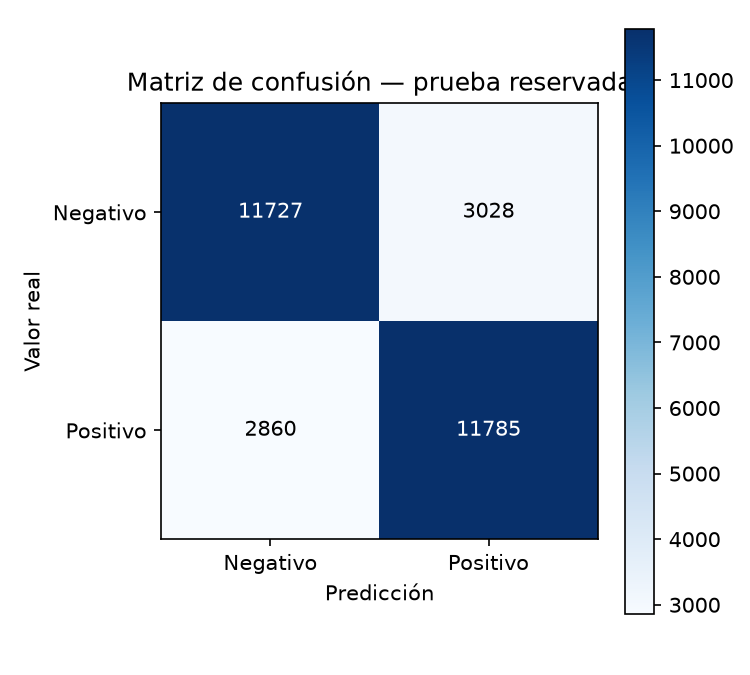
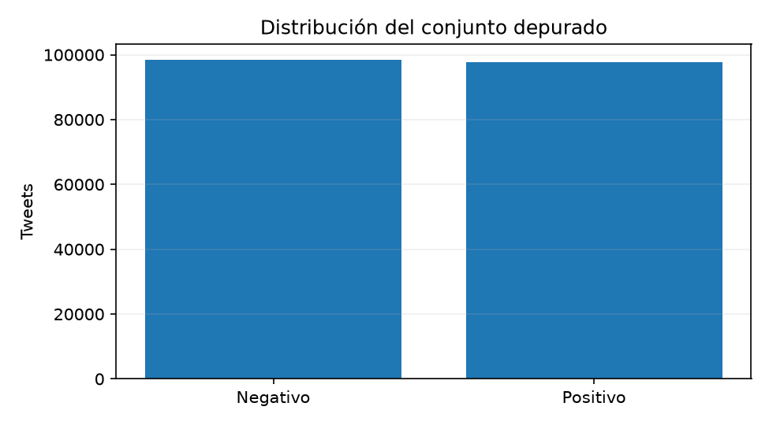

<p align="center">
  
</p>

<div align="center">

# 🧠 NEXUS MENTIS — NEXUS ANALYZE

### 📊 Módulo 1 · Análisis de sentimientos en redes sociales

**Procesamiento del lenguaje natural · Machine Learning · Evaluación reproducible · Aplicación didáctica**

**🐍 Python 3.11 · ⚡ FastAPI · 🧮 scikit-learn · 🌐 HTML/CSS/JavaScript · 🐳 Docker**

[📁 Repositorio GitHub](https://github.com/edtech-mx-ve/nexus-mentis-analyze-m1) · **☁️ Aplicación Cloud: pendiente de despliegue**

</div>

---

## 1. 📍 Estado actual

Aplicación académica para estudiar, comparar y aplicar técnicas de inteligencia artificial a un **dataset histórico de Twitter (actualmente X)**. Clasifica textos en **sentimiento positivo o negativo**, expone los resultados mediante una API y permite interactuar con ellos desde una interfaz web.

| Elemento | Estado del Módulo 1 |
|---|---|
| Proyecto | **NEXUS MENTIS — NEXUS ANALYZE** |
| Práctica académica | **Práctica 1: análisis, implementación y prueba de técnicas de IA a un dataset de redes sociales** |
| Fuente de datos | **Sentiment140** (tweets históricos en inglés) |
| Corpus original | **1.600.000 tweets** |
| Muestra utilizada | **200.000 tweets** |
| Registros preparados | **195.997 tweets** |
| Representación | **TF-IDF**, unigramas y bigramas; hasta **40.000 características** |
| Modelo activo | **Regresión logística** |
| F1 macro de validación | **80,44 %** |
| F1 macro de prueba | **79,97 %** |
| Exactitud de prueba | **79,97 %** |
| Evaluación final | **29.400 tweets reservados** |
| Inferencia bilingüe | **Inglés directo**; **español → inglés** con Argos Translate local |
| Estado GitHub | ✅ Código, README y artefactos publicados en `main` |
| Estado de despliegue | ⏳ Pendiente de verificar en el proveedor Cloud |

> **Resultado de referencia:** el desempeño formal del modelo corresponde a la **prueba reservada en inglés**. No debe presentarse como una medición del rendimiento general en español.

---

## 2. 🎯 Objetivo y alcance

**Objetivo:** analizar un conjunto de publicaciones de redes sociales, preparar los datos, implementar y comparar clasificadores de sentimientos, evaluar sus resultados y comunicar el proceso mediante una aplicación didáctica.

**Alcance del Módulo 1:**

- Estudio de un dataset real y su procedencia.
- Preparación de texto y representación NLP.
- Comparación de **Naive Bayes**, **SVM lineal** y **regresión logística**.
- Evaluación con métricas, matriz de confusión y visualizaciones.
- Predicción de tweets introducidos por el usuario, en inglés o español.
- Comunicación académica del método, resultados y limitaciones.

La aplicación **no** descarga publicaciones de X en tiempo real, **no** procesa el corpus entero en cada ejecución y **no** incluye entrenamiento automático durante una predicción. La optimización a gran escala pertenece a una etapa posterior, fuera de este módulo.

---

## 3. 🖥️ ¿Qué hace la aplicación?

La interfaz organiza la experiencia en **cinco etapas didácticas**:

| Etapa | Contenido |
|---|---|
| **📂 Datos** | Origen, volumen, preparación y particiones del dataset |
| **🔤 NLP** | Normalización del texto, términos, n-gramas y TF-IDF |
| **🤖 Modelos** | Clasificadores candidatos y comparación de resultados |
| **📈 Evaluación** | Métricas, gráficas y matriz de confusión |
| **🧪 Laboratorio** | Entrada libre de un tweet y clasificación con el modelo activo |

Además, el apartado **Información y apoyo** ofrece las pestañas **Acerca de, Dataset, Trivia, Ayuda e Institucional**.

El Laboratorio **no usa etiquetas de ejemplo predefinidas** para decidir el sentimiento: envía el texto al modelo persistido.

---

## 4. 🔁 Flujo de inferencia

```text
Tweet ingresado por el usuario
              │
              ▼
   Validación de la entrada
              │
              ▼
    ¿Está escrito en español?
         ┌────┴────┐
         │         │
        Sí         No (inglés)
         │         │
         ▼         │
 Traducción local   │
  ES → EN (Argos)   │
         │         │
         └────┬────┘
              ▼
    Normalización del texto
              ▼
      Vectorización TF-IDF
              ▼
  Regresión logística entrenada
              ▼
  Sentimiento positivo / negativo
              ▼
  Resultado y trazabilidad didáctica
```

El entrenamiento y la inferencia son procesos independientes. **La aplicación carga `model.joblib` y no reentrena para responder cada consulta.** La traducción ES→EN constituye una adaptación de entrada y no una nueva evaluación formal del clasificador.

---

## 5. 📚 Dataset: Sentiment140

**Sentiment140** es un conjunto histórico de **1,6 millones de tweets en inglés** utilizado en investigación de análisis de sentimientos. Su etiquetado original incluye los valores **`0` (negativo)** y **`4` (positivo)**; aquí se interpretan como las dos clases del problema.

| Conjunto | Cantidad | Uso |
|---|---:|---|
| Dataset original | **1.600.000** | Fuente académica |
| Muestra del estudio | **200.000** | Experimento reproducible del Módulo 1 |
| Registros preparados | **195.997** | Textos conservados tras la preparación |
| Entrenamiento | **137.197** | Ajuste de clasificadores |
| Validación | **29.400** | Comparación y selección |
| Prueba reservada | **29.400** | Medición final del modelo seleccionado |

**Fuentes y créditos**

- [Stanford — archivo histórico de Sentiment140](https://cs.stanford.edu/people/alecmgo/trainingandtestdata.zip).
- [Go, Bhayani y Huang (2009), *Twitter Sentiment Classification using Distant Supervision*](https://cs.stanford.edu/people/alecmgo/papers/TwitterDistantSupervision09.pdf).
- [Kaggle — Sentiment140 (referencia complementaria)](https://www.kaggle.com/datasets/kazanova/sentiment140).

**Relación con Big Data:** el caso permite discutir *volumen*, *variedad* y *velocidad* de la información social. Este módulo utiliza una **muestra local**: no implementa sistemas distribuidos ni procesamiento en streaming.

---

## 6. 🔤 Preparación de datos y NLP

El pipeline separa las etapas de **lectura y validación**, **preparación del texto**, **transformación en características** y **clasificación**. Antes de entrenar se controlan entradas inválidas y se realiza una separación de datos para evitar evaluar sobre los mismos textos utilizados para ajustar el clasificador.

La representación activa es **TF-IDF de palabras**, configurada con:

| Parámetro | Configuración |
|---|---|
| Vectorizador | `TfidfVectorizer` |
| N-gramas | `(1, 2)` — unigramas y bigramas |
| Máximo de características | `40_000` |
| `min_df` | `2` |
| `max_df` | `0.995` |
| `sublinear_tf` | `True` |
| `strip_accents` | `unicode` |

La representación TF-IDF transforma el texto en valores numéricos útiles para el clasificador. **No equivale a comprensión semántica completa**: ironía, sarcasmo, contexto y cambios de intención pueden causar errores.

---

## 7. 🤖 Modelos comparados y modelo activo

Durante la fase de validación se compararon tres algoritmos sobre el problema binario:

| Clasificador | F1 macro de validación |
|---|---:|
| **Regresión logística** ✅ | **80,44 %** |
| SVM lineal | 79,04 % |
| Naive Bayes | 78,72 % |

La **regresión logística** se conservó como modelo activo para la aplicación publicada. Los experimentos alternativos no sustituyen el clasificador operativo ni se despliegan como modelos paralelos.

**Artefactos de inferencia:**

```text
artifacts/sentiment140_real_200k/
├── model.joblib
├── report.json
├── class_distribution.png
└── confusion_matrix.png
```

`model.joblib` contiene el pipeline entrenado; `report.json` conserva información y métricas del experimento. Las dos imágenes aportan evidencias visuales agregadas.

---

## 8. 📈 Evaluación formal

Resultados sobre el **conjunto de prueba reservado de 29.400 tweets en inglés**:

| Indicador | Resultado |
|---|---:|
| **F1 macro** | **79,97 %** |
| **Exactitud (accuracy)** | **79,97 %** |
| Tweets de prueba | **29.400** |
| Predicciones correctas | **23.512** |
| Predicciones incorrectas | **5.888** |

### Matriz de confusión

| Clase real \ Predicción | Negativo | Positivo |
|---|---:|---:|
| **Negativo** | **11.727** | 3.028 |
| **Positivo** | 2.860 | **11.785** |



### Distribución de clases



> El **79,97 %** es una métrica estadística sobre tweets de prueba en inglés. No es una garantía de acierto para cualquier tweet, idioma o dominio.

---

## 9. 🧪 Pruebas funcionales

Se efectuaron **10 comprobaciones manuales seleccionadas (10/10 correctas)** con textos sencillos en inglés y español, para verificar el recorrido entre la interfaz y el clasificador.

| Tipo | Qué demuestra | Qué no demuestra |
|---|---|---|
| **Evaluación formal** | Rendimiento sobre el conjunto de prueba reservado | Ausencia total de errores |
| **Prueba funcional** | Que la interfaz, API, traducción y predicción pueden funcionar con casos concretos | Accuracy general del modelo |
| **Prueba Cloud** | Que el contenedor inicia, carga artefactos y responde en el proveedor | Calidad estadística nueva |

Por tanto, **10/10 no significa 100 % de precisión**. Además, la evaluación formal en español sigue siendo una limitación del estudio.

---

## 10. 🏗️ Arquitectura y estructura del repositorio

```text
nexus-mentis-analyze-m1/
│
├── README.md
├── Dockerfile
├── requirements-cloud.txt
├── cloud_entry.py
├── cloud_preflight.py
├── MANIFEST_SHA256.txt
├── .gitignore
├── .dockerignore
│
├── artifacts/
│   └── sentiment140_real_200k/
│       ├── model.joblib
│       ├── report.json
│       ├── class_distribution.png
│       └── confusion_matrix.png
│
└── nexus_mentis/
    ├── __init__.py
    ├── api.py
    ├── cli.py
    ├── data.py
    ├── model.py
    ├── translation.py
    ├── nlp_trace.py
    ├── insights.py
    ├── comparison_charts.py
    ├── release_check.py
    ├── bilingual_eval.py
    ├── controlled_study.py
    ├── linguistic_signals.py
    ├── source.py
    ├── specialized_training.py
    ├── specialized_training_v094.py
    ├── translation_quality.py
    ├── tweet_regression.py
    └── web/
        ├── modulo1.html
        ├── modulo1.css
        ├── modulo1.js
        ├── modulo1_info.css
        ├── modulo1_info.js
        ├── favicon.png
        └── nexus-logo.webp
```

### Responsabilidades principales

| Componente | Responsabilidad |
|---|---|
| `nexus_mentis/api.py` | API FastAPI y servidor de archivos estáticos |
| `nexus_mentis/data.py` | Lectura, validación y normalización de tweets |
| `nexus_mentis/model.py` | Pipeline, entrenamiento, comparación y evaluación |
| `nexus_mentis/translation.py` | Traducción ES→EN mediante Argos Translate local |
| `nexus_mentis/nlp_trace.py` | Explicación del procesamiento NLP |
| `nexus_mentis/web/` | Interfaz didáctica HTML, CSS y JavaScript |
| `cloud_entry.py` | Entrada de ejecución del servicio Cloud |
| `cloud_preflight.py` | Verificaciones previas de modelo, traductor e interfaz |
| `artifacts/.../model.joblib` | Pipeline entrenado para inferencia |
| `artifacts/.../report.json` | Procedencia y métricas persistidas |

El repositorio reúne **lo necesario para ejecutar y documentar el Módulo 1**. Los archivos dedicados a estudios adicionales conservan funciones del proyecto, pero **no activan automáticamente modelos alternativos ni nuevos entrenamientos**.

---

## 11. 🐳 Ejecución con Docker (recomendada)

Con Docker instalado, desde la raíz del repositorio:

```bash
docker build -t nexus-analyze-m1 .
docker run --rm -p 10000:10000 nexus-analyze-m1
```

Abrir en el navegador:

**http://localhost:10000**

Durante la construcción se instalan las dependencias y el paquete local de traducción **español → inglés**; esa fase requiere acceso a Internet. Al iniciar, el servicio carga el **modelo persistido** y ejecuta un único proceso Uvicorn.

El Dockerfile no descarga ni utiliza el dataset original para entrenar.

---

## 12. 🐍 Instalación local con Python

Se recomienda **Python 3.11**. En Windows PowerShell, desde la raíz del repositorio:

```powershell
# Crear el entorno virtual
py -3.11 -m venv .venv

# Activarlo
Set-ExecutionPolicy -Scope Process -ExecutionPolicy RemoteSigned
.\.venv\Scripts\Activate.ps1

# Instalar dependencias de ejecución
python -m pip install --upgrade pip
python -m pip install -r requirements-cloud.txt

# Instalar el modelo de traducción ES → EN (una vez)
python -m nexus_mentis.cli setup-translation

# Señalar el modelo ya entrenado
$env:NEXUS_ARTIFACT_DIR = (
    Resolve-Path '.\artifacts\sentiment140_real_200k'
).Path

# Iniciar el servicio
python -m uvicorn cloud_entry:app --host 127.0.0.1 --port 10000
```

**Interfaz:** `http://localhost:10000`

**Documentación interactiva de la API:** `http://localhost:10000/docs`

> **Compatibilidad:** el artefacto `joblib` debe probarse con las versiones efectivas de Python y scikit-learn del entorno de ejecución. La publicación del repositorio por sí sola **no verifica** la compatibilidad binaria de dependencias ni el inicio del contenedor.

---

## 13. 🔌 API y comprobaciones

| Método | Ruta | Función |
|---|---|---|
| `GET` | `/` | Interfaz web |
| `GET` | `/healthz` | Preparación estricta de modelo y traductor para Cloud |
| `GET` | `/api/health` | Estado del modelo y la traducción |
| `GET` | `/api/metrics` | Resultados del reporte académico |
| `POST` | `/api/predict` | Clasificación de una entrada validada |
| `GET` | `/docs` | Documentación OpenAPI de FastAPI |

Ejemplo de solicitud:

```json
{
  "text": "Me encantó la atención y el servicio.",
  "language": "es"
}
```

Para probar con PowerShell, una vez iniciado el servidor:

```powershell
Invoke-RestMethod 'http://localhost:10000/healthz'
Invoke-RestMethod 'http://localhost:10000/api/health'
Invoke-RestMethod 'http://localhost:10000/api/metrics'

$Body = @{
    text = 'I really enjoyed this movie.'
    language = 'en'
} | ConvertTo-Json

Invoke-RestMethod `
    -Uri 'http://localhost:10000/api/predict' `
    -Method Post `
    -ContentType 'application/json; charset=utf-8' `
    -Body $Body
```

El sistema debe rechazar entradas inválidas y no anunciar `ready` si falta un requisito esencial del servicio.

---

## 14. ☁️ Despliegue en Render

**Repositorio GitHub:** [edtech-mx-ve/nexus-mentis-analyze-m1](https://github.com/edtech-mx-ve/nexus-mentis-analyze-m1) (privado al momento de la publicación inicial).

| Configuración | Valor |
|---|---|
| Tipo de servicio | **Web Service** |
| Fuente | **Repositorio de GitHub** |
| Repositorio | `edtech-mx-ve/nexus-mentis-analyze-m1` |
| Rama | `main` |
| Entorno | **Docker** |
| Dockerfile | `./Dockerfile` |
| Directorio raíz | Raíz del repositorio |
| Base de datos | No requerida |
| Health check | `/healthz` |
| Puerto | Gestionado mediante `PORT`; valor por defecto en Docker: `10000` |

**Antes de declarar exitoso el despliegue**, confirmar que el build finaliza, `/healthz` responde correctamente, el reporte muestra el modelo real (`demo: false`), la interfaz carga y la traducción ES→EN puede clasificar entradas.

Argos Translate necesita recursos adicionales de memoria; una instancia pequeña puede resultar insuficiente. **GitHub publicado ≠ aplicación desplegada.** No se proporciona una URL Cloud hasta verificar que el proveedor la haya asignado.

---

## 15. ✅ Verificaciones de código y control de versiones

Desde el repositorio:

```powershell
# Comprobar sintaxis de los puntos principales
python -m py_compile `
    .\cloud_entry.py `
    .\cloud_preflight.py `
    .\nexus_mentis\api.py `
    .\nexus_mentis\data.py `
    .\nexus_mentis\model.py `
    .\nexus_mentis\translation.py

# Higiene de Git
git diff --check
git status --short
```

Para publicar **solo cambios revisados**:

```powershell
git add README.md
git diff --cached --check
git commit -m "docs: mejorar README academico de NEXUS ANALYZE"
git push origin main
```

La compilación de Python verifica sintaxis; las comprobaciones Git verifican cambios y formato. **Ninguna de ellas sustituye las pruebas de inferencia ni la evaluación formal.**

---

## 16. 🔐 Robustez y seguridad

- Validación de las solicitudes (tipo de idioma y longitud del texto).
- Separación entre la interfaz, la API, el modelo persistido y la traducción.
- Encabezados de seguridad HTTP y políticas restrictivas de contenido.
- Respuestas de error cuando faltan modelo o traducción.
- Sin descarga del traductor durante solicitudes de usuarios.
- API académica sin mecanismos de autenticación específicos: no enviar información sensible.
- `joblib` puede ejecutar código al cargar un artefacto malicioso: **utilizar solo modelos generados y verificados por el proyecto**.

No incluir en el repositorio:

```text
.venv/
__pycache__/
*.pyc
.env
credenciales
dataset_original.csv
respaldos/
archivos temporales
```

La publicación pública del código y las condiciones de reutilización de terceros deben revisarse por separado; este README **no concede licencias** sobre Sentiment140 ni sus contenidos.

---

## 17. ♻️ Reproducibilidad y trazabilidad

La metodología distingue:

**Dataset → validación → limpieza → exploración → TF-IDF → comparación → validación → selección → prueba final → reporte → inferencia.**

La evaluación reproduce conceptos de separación entrenamiento/validación/prueba, semilla de experimentación, selección basada en validación, reporte persistido y visualización de resultados.

El despliegue **no necesita el dataset original** porque usa los artefactos entrenados. Para repetir el estudio completo haría falta obtener la fuente histórica, configurar las dependencias correspondientes y ejecutar el pipeline de entrenamiento de forma separada.

El repositorio incluye `MANIFEST_SHA256.txt` para consultar las huellas registradas durante la exportación. **La comprobación del modelo en un contenedor nuevo aún debe ejecutarse.**

---

## 18. ⚠️ Limitaciones

- **Clasificación binaria:** no existe una tercera clase neutral.
- **Dominio:** el modelo se evaluó formalmente con tweets históricos en inglés.
- **Español:** se utiliza traducción local ES→EN; no hay una cifra de accuracy formal equivalente.
- **Lenguaje figurado:** sarcasmo, ironía y estructuras de contraste pueden producir errores.
- **Contexto:** la clasificación de texto aislado no necesariamente refleja intención real del autor.
- **Datos:** pueden existir sesgos de época, contexto y selección de la muestra.
- **Rendimiento Cloud:** los tiempos y recursos reales dependen del proveedor y requieren pruebas.
- **Uso académico:** no es una herramienta para decisiones de alto impacto ni un monitor de X en tiempo real.

---

## 19. 🎓 Contexto académico y fuentes

| Dato | Información |
|---|---|
| 🏛️ Institución | **Instituto Internacional de Aguascalientes** |
| 🎓 Programa | **Maestría en Inteligencia Artificial para la Transformación Digital** |
| 📘 Asignatura | **Tópicos de IA para la Transformación Digital** |
| 🧑‍🎓 Estudiante | **Antonio Nicolás Toro González** |
| 👨‍🏫 Tutor | **Dr. Francisco Javier Luna Rosas** |
| 🧠 Proyecto | **NEXUS MENTIS — NEXUS ANALYZE (Módulo 1)** |

### Referencias técnicas y académicas

- [Stanford — Sentiment140: archivo original](https://cs.stanford.edu/people/alecmgo/trainingandtestdata.zip)
- [Go, Bhayani y Huang (2009) — *Twitter Sentiment Classification using Distant Supervision*](https://cs.stanford.edu/people/alecmgo/papers/TwitterDistantSupervision09.pdf)
- [Kaggle — Sentiment140](https://www.kaggle.com/datasets/kazanova/sentiment140)
- [scikit-learn](https://scikit-learn.org/stable/)
- [FastAPI](https://fastapi.tiangolo.com/)
- [Argos Translate](https://www.argosopentech.com/)
- [Docker](https://docs.docker.com/)
- [Render](https://render.com/docs/web-services)
- [Instituto Internacional de Aguascalientes](https://www.iinternacional.edu.mx/)

### Enlaces del proyecto

- **📁 GitHub:** https://github.com/edtech-mx-ve/nexus-mentis-analyze-m1
- **🌐 Aplicación Cloud:** pendiente de despliegue y verificación.
- **🗃️ Dataset:** https://cs.stanford.edu/people/alecmgo/trainingandtestdata.zip

---

<div align="center">

### 🧠 NEXUS MENTIS — NEXUS ANALYZE

**📥 Tweet → 🔤 NLP + TF-IDF → 🤖 Regresión logística → 😊/😞 Sentimiento**

**📊 F1 macro de prueba: 79,97 % · 29.400 tweets reservados**

*Práctica 1 · Módulo 1 · Instituto Internacional de Aguascalientes*

</div>
